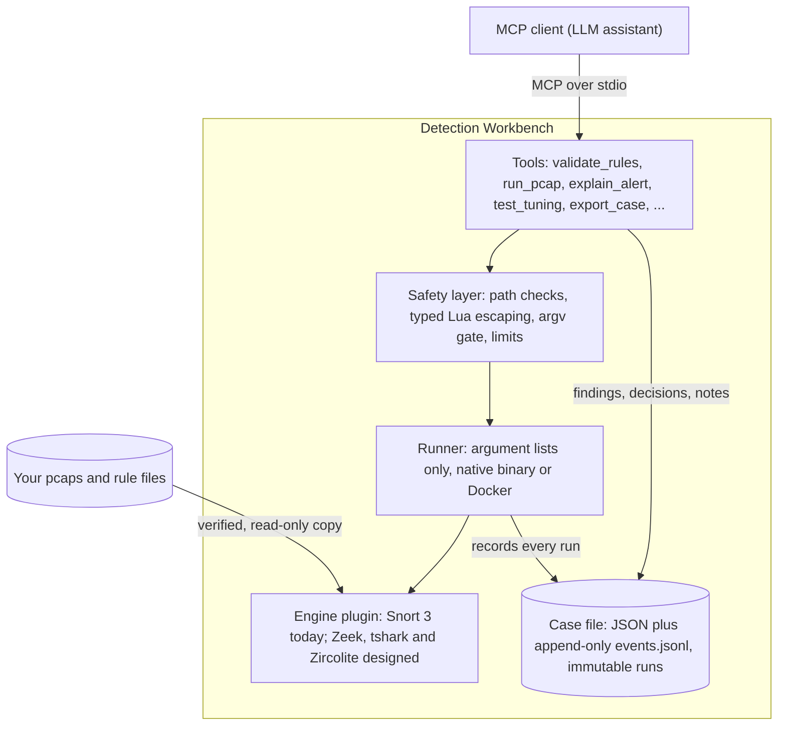

# Evidence-backed detection engineering

**On this page:** [The idea](#the-idea) · [How it works](#how-it-works) · [Walkthrough](#walkthrough-a-noisy-rule) · [Use cases](#use-cases) · [Output examples](#what-the-output-looks-like) · [Example output](#example-output) · [What "proved" means](#what-proved-means-here) · [Findings along the way](#things-found-along-the-way) · [Limits and next steps](#limits-and-whats-next)

## The idea

A language model is good at drafting a rule and explaining a protocol. It is not good at knowing whether that rule fires on *your* traffic, so a plain chat session can only guess. The workbench removes the guessing. It is an [MCP](https://modelcontextprotocol.io) server: Any MCP client connects to it and gets tools that run Snort 3 on files on disk and return structured results.

- **The client's model does the reasoning:** what to write, what a result means, what to try next.
- **The server provides the facts:** real Snort output, parsed, bounded and recorded.
- **The analyst decides.** Nothing is autonomous, and nothing touches production. The workbench only reads files you register.

## How it works



Every tool that runs an engine records a **run** in the active case: engine and version, the exact argument list, the SHA-256 of each input and of the rule set, duration, exit status, and a pointer to parsed results. Runs are written once and never edited. **Findings** tie a statement to the runs that support it. **Decisions** record a tuning change with its before and after run ids and the reason. The format is documented and versioned in [case-schema.md](case-schema.md).

## Walkthrough: a noisy rule

This is the bundled demo ([`scripts/demo_noisy_rule.py`](../scripts/demo_noisy_rule.py)), run on a synthetic 1,910-packet capture: one scanner (10.0.4.20) making 300 requests, five ordinary clients, one request carrying a known marker string, and some DNS. The rule set has a deliberately sloppy rule, SID 1000042, that matches any HTTP `GET`.

> **You ask:** Here's a capture and our rules. What fired, is any of it real, and why is SID 1000042 so noisy?

### 1. Register, summarize, validate

```text
create_case(title="Noisy SID 1000042 on the proxy capture")
register_evidence(path="~/captures/noisy.pcap")      -> e-0001  (sha256 recorded)
register_evidence(path="~/rules/noisy.rules")        -> e-0002
pcap_summary(e-0001)       1910 packets, top source 10.0.4.20 (1200 packets)
validate_rules(e-0002)     ok, 0 errors
```

### 2. Run and look at the counts

```text
run_pcap(pcap_id="e-0001", rules_id="e-0002")        -> r-0003, 316 alerts
  sid 1000042   315   LOCAL noisy GET anything
  sid 1000001     1   LOCAL WBTEST marker in URI
```

Two rules fired. One of them fires 315 times.

### 3. Find out why it's noisy

```text
suggest_tuning_targets(run_id="r-0003")
  sid 1000042   315 hits, 7 distinct sources, 1 destination
  top source 10.0.4.20 accounts for 95%
```

The facts point two ways: one source dominates, *and* the rule matches every GET. The model can say which it thinks matters, but a suppression and a rewrite are different claims, and both can be tested.

### 4. Look at one hit

```text
explain_alert(run_id="r-0003", alert_idx=0)
  matched options: content:"GET"  -> found in the reassembled stream
```

The only thing the rule matched is the method of an ordinary request. A common string present in every request is an *incidental* match, not a meaningful one.

### 5. Try the fix, two ways, and compare

```text
# Option A: suppress the scanner
test_tuning(before_run_id="r-0003",
            change={"kind":"suppress","sid":1000042,"track":"by_src","ip":"10.0.4.20"},
            reason="known scanner")
  sid 1000042   315 -> 15
  sid 1000001     1 ->  1

# Option B: fix the rule
test_tuning(before_run_id="r-0003",
            change={"kind":"rule_edit","sid":1000042,"rule":"alert http ... http_uri; content:\"/download/\",fast_pattern; ... rev:2;"},
            reason="Anchor on the /download/ path instead of matching every GET")
  sid 1000042   315 ->  1
  sid 1000001     1 ->  1
  other SIDs changed: none
```

Suppressing the scanner still leaves 15 noisy hits from the five ordinary clients, because the rule is the problem, not the address. The rewrite removes 314 hits and keeps the real detection. Each `test_tuning` call re-runs the same pcap, so the comparison is like for like, and it records a decision (status *proposed*) with both run ids.

### 6. Write it down

```text
add_finding("SID 1000042 fires 315 times, 95% from 10.0.4.20; it matches any GET, so it is too broad.", run_ids=["r-0003"])
update_finding("f-0001", status="confirmed")
update_case(summary="**Question.** ... **Findings.** ... cites f-0001, r-0003 ... **Limits.** One synthetic capture ...", status="closed")
export_case(format="markdown")          -> the case report (below)
export_case(format="timesketch_csv")    -> message, datetime, timestamp_desc + alert columns
```

`update_case` is where the analysis goes. The report is assembled from recorded data (evidence, per-run alert tables, decisions, caveats, an event timeline), and the conclusions in it are the summary written here, with run and finding ids cited so every claim can be traced. The workbench does not write conclusions itself.

> **Read the result carefully.** The rewrite works on this capture. Whether `/download/` is the right anchor for production traffic is a judgment the workbench cannot make from one synthetic file. It says so in its instructions to the client, and so should whoever signs the change off.

## Use cases

### Detection engineer: write and test a rule

> **You ask:** Write a rule that catches this HTTP request in the capture, test it, and make sure it doesn't fire on the rest of the traffic.

1. `pcap_summary` to see what the capture contains.
2. The model drafts a rule using `http_uri` and a distinctive `content`; `validate_rules` checks it with Snort in about a quarter of a second, so the write-fix loop stays fast.
3. `run_pcap` shows it fires once; `get_alerts` confirms that hit is the target request.
4. The same run's counts show it stayed quiet on everything else in the capture, which is the half of the test people usually skip.

On the bundled capture this finds the marker request exactly once among 1,910 packets.

### SOC analyst (tier 2/3): triage a noisy rule

> **You ask:** Which of my rules are slowest on this capture, and which ones are just noise?

`profile_rules` turns on Snort's rule profiler and returns the slowest rules with checks, matches and time. `suggest_tuning_targets` ranks noisy SIDs by count, distinct sources and how concentrated the hits are. `test_tuning` then proves any proposed suppress, threshold or rule edit before it goes anywhere near a ruleset. The tuning order the server teaches the client: fix the rule first, suppress by address only for known-benign sources, threshold only when volume rather than presence is the signal.

### Incident responder or hunter: handed a capture

> **You ask:** Here's a pcap and our rule set. What fired, is any of it real, and what do the bytes say?

Register the pcap and your rules (local rules, or any rule file you have on disk), `run_pcap`, then walk the interesting alerts with `explain_alert`: rule options, 5-tuple, direction, a bounded hex dump, and which `content` and `pcre` options appear in the payload at what offsets. Findings are tied to run ids as you go, so the write-up for the incident is the case export rather than a reconstruction from memory. The CSV export is shaped for Timesketch's documented import columns, so alerts can sit on a timeline with other evidence.

### Small team: one person covers everything

When the same person writes rules, triages alerts and answers incidents, the thing that gets lost is the reasoning. The case file keeps it: which capture, which rules (by hash), what was run, what was concluded, what was changed and why. Months later, `get_case` and the Markdown report answer "why is SID 1000042 suppressed?" without anyone's memory. It also gives a second reviewer something to check: the before and after counts, not a claim.

### Migrating from Snort 2

If `snort2lua` ships with your Snort 3 install, `convert_snort2` runs it on a registered Snort 2 rules file or `snort.conf` and leaves the output in the run directory for review. In a test it turned `uricontent:"/admin"; nocase;` into `http_uri; content:"/admin",nocase;`. Validate the result before you trust it.

## What the output looks like

### Validation that unmasks cascading errors

A missing `;` makes Snort misreport the following rule and can hide its real error. The workbench re-checks the suspect rules one at a time. On the bundled bad rule file:

```text
line 2  sid 1000011  unknown rule keyword: contnet.
        "contnet" is not a Snort 3 rule option. Check the spelling or whether it is a Snort 2 option.
line 3  sid 1000012  syntax error / unknown rule action / incomplete rule      (missing ';')
line 4  sid 1000013  pcre2 compile of '(abc' failed at offset 4 : missing closing parenthesis
line 7  sid 1000014  'depth' must be in 3:65535, inclusive
rechecked individually: lines 3, 4, 5
workbench_lint: line 5 "No sid. Snort 3 loads this rule silently without one"
```

The line-4 pcre error did not appear in Snort's single pass; it surfaced only after the re-check. The missing `sid` on line 5 is something Snort never reports, so it comes from the workbench's own lint, labelled `workbench_lint` so it is never mistaken for Snort's output.

### An alert explained down to the packet

```text
explain_alert(...)   sid 1000001  "WBTEST marker in URI"
  packet:   TCP 10.0.4.20:40000 -> 203.0.113.5:80  C2S  service=http  pkt_gen=stream_tcp
  trigger packet: 7        data packets: [6]
  content:"WBTEST-MARKER"  buffer=http_uri  fast_pattern
    found in reassembled stream at offset 14  (packet 6, payload offset 14)
  00000000  47 45 54 20 2f 64 6f 77 6e 6c 6f 61 64 2f 57 42  |GET /download/WB|
  00000010  54 45 53 54 2d 4d 41 52 4b 45 52 2d 37 37 33 31  |TEST-MARKER-7731|
```

Note the packet numbers. Snort reports 7, the packet that triggered the flush; the bytes are in packet 6. If you took Snort's number at face value you would look at the wrong packet.

### A result that tells you it may be incomplete

```text
run_pcap(flow_endings.pcap)
  stream_caveats: 5 TCP flows, 4 with data the peer never ACKed, 1 one-sided
  "Snort 3.10 does not run service inspectors on TCP data its peer never ACKed, so rules on
   service buffers (http_uri and similar) can miss on these flows while raw-packet rules still fire."
```

Five flows each carry the same request. A rule on `http_uri` fired on exactly one: the flow whose server acknowledged the request.

## Example output

Everything below was captured from a real session on the bundled fixtures (Snort 3.10.0.0 in Docker), using the same calls as the [walkthrough](#walkthrough-a-noisy-rule). Where a response was shortened, a note says so; nothing was edited by hand. These are tool responses as the client receives them.

### `pcap_summary`

Trimmed: `top_sources` and `top_conversations` are cut to three entries each (the real response lists ten).

<details>
<summary>Show the response</summary>

```json
{
  "run_id": "r-0001",
  "evidence_id": "e-0001",
  "packets": 1910,
  "bytes": 149242,
  "non_ip_packets": 0,
  "first_packet": "2023-11-14T22:13:20.000000Z",
  "last_packet": "2023-11-14T22:13:23.818178Z",
  "duration_s": 3.818178,
  "protocols": { "TCP": 1890, "UDP": 20 },
  "top_sources": [["10.0.4.20", 1200], ["203.0.113.5", 630], ["10.0.4.34", 16]],
  "top_conversations": [
    { "src": "10.0.4.20", "dst": "203.0.113.5", "packets": 1200 },
    { "src": "203.0.113.5", "dst": "10.0.4.20", "packets": 600 },
    { "src": "10.0.4.34", "dst": "203.0.113.5", "packets": 16 }
  ],
  "services": { "http/tcp": 1890, "dns/udp": 20 }
}
```

</details>

### `validate_rules`

<details>
<summary>Show the response</summary>

```json
{
  "run_id": "r-0002",
  "status": "ok",
  "ok": true,
  "snort_ok": true,
  "errors": [],
  "warnings": [],
  "rechecked_individually": [],
  "rules_checked": 3
}
```

</details>

The real response also carries a `lint` list of hygiene findings; it is omitted here because this rule set has none worth showing. The earlier [bad-rules example](#validation-that-unmasks-cascading-errors) shows an error-bearing response.

### `run_pcap`

Trimmed: `first_alerts` is cut to one entry (the real response lists up to 200, and its `first_alerts_note` says so), and the per-alert `b64_data` field is not returned.

<details>
<summary>Show the response</summary>

```json
{
  "run_id": "r-0003",
  "status": "ok",
  "total_alerts": 316,
  "truncated_at_parse_limit": false,
  "by_sid": [
    { "gid": 1, "sid": 1000042, "rev": 1, "msg": "LOCAL noisy GET anything",
      "count": 315, "distinct_sources": 7, "distinct_destinations": 1 },
    { "gid": 1, "sid": 1000001, "rev": 1, "msg": "LOCAL WBTEST marker in URI",
      "count": 1, "distinct_sources": 1, "distinct_destinations": 1 }
  ],
  "first_alerts": [
    { "alert_idx": 0, "datetime": "2023-11-14T22:13:20.006000Z", "seconds": 1700000000,
      "pkt_num": 5, "pkt_gen": "stream_tcp", "proto": "TCP", "dir": "C2S",
      "src_ip": "10.0.4.20", "src_port": 20001, "dst_ip": "203.0.113.5", "dst_port": 80,
      "service": "http", "gid": 1, "sid": 1000042, "rev": 1, "msg": "LOCAL noisy GET anything",
      "class": "none", "priority": 0, "action": "allow" }
  ],
  "first_alerts_note": "first 200 of 316 (use get_alerts to page)",
  "stream_caveats": { "tcp_flows": 315, "unacked_flows": 0, "one_sided_flows": 0,
                      "examples": [], "explanation": null }
}
```

</details>

`stream_caveats` is all zeros here, which is what you want to see: every flow in this capture was acknowledged, so Snort could inspect all of it.

### `suggest_tuning_targets`

<details>
<summary>Show the response</summary>

```json
{
  "run_id": "r-0003",
  "total_alerts": 316,
  "targets": [
    { "gid": 1, "sid": 1000042, "msg": "LOCAL noisy GET anything", "count": 315,
      "distinct_sources": 7, "distinct_destinations": 1,
      "top_source": "10.0.4.20", "top_source_share": 0.9524,
      "observations": ["95% of hits come from 10.0.4.20"] },
    { "gid": 1, "sid": 1000001, "msg": "LOCAL WBTEST marker in URI", "count": 1,
      "distinct_sources": 1, "distinct_destinations": 1,
      "top_source": "10.0.4.77", "top_source_share": 1.0, "observations": [] }
  ],
  "note": "Ranked by count. One capture is one sample; prove any change with test_tuning."
}
```

</details>

### `explain_alert`

This one is for the marker alert on the small `http_marker.pcap` fixture (the walkthrough's rule 1000001). Trimmed: the rule's `options` list is cut to four entries, the `payload.lines` dump to three lines, and the `inspector_buffer` section is left out.

<details>
<summary>Show the response</summary>

```json
{
  "alert": { "alert_idx": 3, "datetime": "2023-11-14T22:13:20.050000Z", "gid": 1, "sid": 1000001,
             "rev": 1, "msg": "WBTEST marker in URI", "pkt_num": 7, "pkt_gen": "stream_tcp",
             "action": "allow", "class": "none", "priority": 0 },
  "packet": { "proto": "TCP", "src": "10.0.4.20:40000", "dst": "203.0.113.5:80", "direction": "C2S",
              "service": "http", "pkt_gen": "stream_tcp", "trigger_packet": 7, "data_packets": [6] },
  "rule": {
    "text": "alert http any any -> any any ( msg:\"WBTEST marker in URI\"; http_uri; content:\"WBTEST-MARKER\",fast_pattern; sid:1000001; rev:1; classtype:trojan-activity; )",
    "line": 1,
    "header": "alert http any any -> any any",
    "options": [
      { "name": "msg", "value": "\"WBTEST marker in URI\"" },
      { "name": "http_uri", "value": null },
      { "name": "content", "value": "\"WBTEST-MARKER\",fast_pattern" },
      { "name": "sid", "value": "1000001" }
    ],
    "services": [],
    "sticky_buffers": ["http_uri"]
  },
  "note": "Snort matched this on reassembled/service data: pkt_num is the packet that triggered the flush (usually the peer's ACK), not necessarily the packet carrying the matched bytes.",
  "contents": [
    { "option": "content:\"WBTEST-MARKER\"", "buffer": "http_uri", "negated": false, "nocase": false,
      "fast_pattern": true, "anchors": {},
      "wire_reassembled": { "found": true, "offsets": [14],
                            "packets": [{ "stream_offset": 14, "pkt": 6, "payload_offset": 14 }] },
      "inspector_buffer": { "found": false, "offsets": [] } }
  ],
  "payload": {
    "source": "reassembled stream, packets [6]",
    "lines": [
      "00000000  47 45 54 20 2f 64 6f 77 6e 6c 6f 61 64 2f 57 42  |GET /download/WB|",
      "00000010  54 45 53 54 2d 4d 41 52 4b 45 52 2d 37 37 33 31  |TEST-MARKER-7731|",
      "00000020  20 48 54 54 50 2f 31 2e 31 0d 0a 48 6f 73 74 3a  | HTTP/1.1..Host:|"
    ],
    "shown": 95, "total": 95, "truncated": 0
  },
  "buffer_caveat": "Sticky-buffer offsets are relative to Snort's normalized buffer; a match in the raw stream shows the bytes are present, not that they sit at that offset in the buffer."
}
```

</details>

Two things worth reading closely. `inspector_buffer.found` is `false` because Snort's own `http_uri` buffer, as returned in the alert, holds the header block rather than the URI; the match is confirmed on the wire bytes instead (`wire_reassembled`, packet 6). And `shown`/`total`/`truncated` describe the real dump, which was cut to three lines only in this document.

### `test_tuning`

<details>
<summary>Show the response</summary>

```json
{
  "applied": true,
  "decision_id": "d-0001",
  "before_run": "r-0003",
  "after_run": "r-0005",
  "counts": {
    "1000001": { "before": 1, "after": 1 },
    "1000042": { "before": 315, "after": 15 }
  },
  "total": { "before": 316, "after": 16 },
  "other_sids_changed": [],
  "note": "Check that the alerts you want to keep (use get_alerts on the after run) still fire. The decision is recorded as 'proposed'.",
  "stream_caveats": { "tcp_flows": 315, "unacked_flows": 0, "one_sided_flows": 0,
                      "examples": [], "explanation": null }
}
```

</details>

This is the suppress-the-scanner variant; the rule-rewrite variant returns the same structure with different counts.

### `export_case`: Markdown report

This is the report exported for the committed [example case](examples/README.md), exactly as exported. The Summary section is the analysis the client wrote with `update_case`; every other section is generated from what was recorded. Placeholders like `<repo>` replace local paths.

<details>
<summary>Show the full report</summary>

`````markdown
# Example: marker rule and SYN-scan noise

Case `example-marker-rule-and-syn-scan-noise` · status **closed** · created 2026-10-23T17:42:02.858666Z · updated 2026-10-23T17:42:03.870582Z

> **At a glance:** 2 engine runs · 2 findings (1 confirmed, 1 open) · 1 decision (1 proposed) · noisiest SID: 1000003 (6 alerts in r-0003)

## Summary

**Question.** Does the marker rule fire on the target request, and which rule in this set is noisy?

**Findings.** The marker rule (sid 1000001) fires exactly once, on the request carrying `WBTEST-MARKER-7731` (f-0001, run r-0003). The only noisy rule is the SYN rule (sid 1000003): 6 alerts, all from one scanner (10.0.4.20) sweeping five ports on 10.0.9.9.

**Tested change.** An `event_filter` limit of one alert per source per minute takes sid 1000003 from 6 to 1 alerts and leaves sids 1000001 and 1000002 unchanged (run r-0004, decision d-0001). It is recorded as `proposed`; nobody has accepted it.

**Limits.** One 13-packet synthetic capture. It shows the change works mechanically, not that a limit of one per minute is right for production traffic.

## Overview

**Captures**

| evidence | packets | first packet | last packet | protocols |
|---|---|---|---|---|
| e-0001 | 13 | 2023-11-14T22:13:20.000000Z | 2023-11-14T22:13:20.120000Z | TCP 11, UDP 2 |

**Engines:** snort 3.10.0.0 (docker)

**Rule sets** (by hash)

| origin | sha256 | used in |
|---|---|---|
| e-0002 · derived from r-0003 | 2870dd02f3d1bf2e… | r-0002, r-0003, r-0004 |

## Evidence

| id | type | path | sha256 | size |
|---|---|---|---|---|
| e-0001 | pcap | <repo>/tests/fixtures/pcaps/http_marker.pcap | e4abeab3ce82ae01f19c8dd3dc7b36a2cd9a7a416b0c4d7463227acb51595dbb | 1133 |
| e-0002 | rules | <repo>/tests/fixtures/rules/good.rules | 2870dd02f3d1bf2e934bf2ab8c180345981417e9e2ac078abfd6b3983e0f6f7f | 357 |

## Findings

- **f-0001** [confirmed] SID 1000001 (marker in URI) fires once, on the target request: data in packet 6, alert reported on packet 7 (the flush trigger).  (runs: r-0003; evidence: e-0001, e-0002)
- **f-0002** [open] SID 1000003 fires 6 times from one scanner; a limit of one alert per source per minute leaves 1.  (runs: r-0003, r-0004; evidence: e-0001, e-0002)

## Results by run

### r-0002 — validate: ok (0 errors, 1 warning, 1 lint note)

### r-0003 — run

9 alerts · status ok

| sid | message | alerts | volume | sources | top source |
|---|---|---|---|---|---|
| 1000003 | WBTEST any SYN | 6 | ██████████ | 1 | 10.0.4.20 (100%) |
| 1000002 | WBTEST any DNS | 2 | ███░░░░░░░ | 1 | 10.0.4.20 (100%) |
| 1000001 | WBTEST marker in URI | 1 | ██░░░░░░░░ | 1 | 10.0.4.20 (100%) |

### r-0004 — tuning · parent `r-0003`

4 alerts · status ok

| sid | message | alerts | volume | sources | top source |
|---|---|---|---|---|---|
| 1000002 | WBTEST any DNS | 2 | ███░░░░░░░ | 1 | 10.0.4.20 (100%) |
| 1000003 | WBTEST any SYN | 1 | ██░░░░░░░░ | 1 | 10.0.4.20 (100%) |
| 1000001 | WBTEST marker in URI | 1 | ██░░░░░░░░ | 1 | 10.0.4.20 (100%) |

## Decisions

### d-0001 — event_filter (proposed)

SYN rule fires on every scan packet; volume, not presence, is the noise

Before `r-0003` → after `r-0004`

| sid | before | after | change |
|---|---|---|---|
| 1000001 | 1 | 1 | no change |
| 1000002 | 2 | 2 | no change |
| 1000003 | 6 | 1 | −83% |

Change: `{"count": 1, "kind": "event_filter", "seconds": 60, "sid": 1000003, "track": "by_src", "type": "limit"}`

## Caveats

- Results describe only the evidence registered in this case. One capture is one sample; they do not show how a rule behaves on other traffic.
- Decisions marked `proposed` have been tested on this evidence but not accepted by a person.

## Timeline

| time (UTC) | event | ref | detail |
|---|---|---|---|
| 2026-10-23T17:42:02.868331Z | case.created | example-marker-rule-and-syn-scan-noise | Example: marker rule and SYN-scan noise |
| 2026-10-23T17:42:02.870460Z | evidence.registered | e-0001 | <repo>/tests/fixtures/pcaps/http_marker.pcap |
| 2026-10-23T17:42:02.874388Z | evidence.registered | e-0002 | <repo>/tests/fixtures/rules/good.rules |
| 2026-10-23T17:42:02.882532Z | run.recorded | r-0001 | summary → ok |
| 2026-10-23T17:42:03.205002Z | run.recorded | r-0002 | validate → ok |
| 2026-10-23T17:42:03.527301Z | run.recorded | r-0003 | run → ok |
| 2026-10-23T17:42:03.529626Z | finding.added | f-0001 | SID 1000001 (marker in URI) fires once, on the target request: data in packet 6, alert re… |
| 2026-10-23T17:42:03.533494Z | finding.updated | f-0001 | status confirmed |
| 2026-10-23T17:42:03.857382Z | run.recorded | r-0004 | tuning → ok |
| 2026-10-23T17:42:03.859501Z | decision.recorded | d-0001 | event_filter |
| 2026-10-23T17:42:03.863302Z | finding.added | f-0002 | SID 1000003 fires 6 times from one scanner; a limit of one alert per source per minute le… |
| 2026-10-23T17:42:03.866915Z | note.added | n-0001 |  |
| 2026-10-23T17:42:03.870544Z | case.updated | example-marker-rule-and-syn-scan-noise | status=closed, summary_chars=759 |

## Notes

- (client, 2026-10-23T17:42:03.866886Z) Synthetic capture bundled with the repository; results say nothing about production traffic.

## Appendix: runs

| id | kind | engine | version | backend | status | duration_s | alerts |
|---|---|---|---|---|---|---|---|
| r-0001 | summary | dpkt |  | native | ok | 0.0 |  |
| r-0002 | validate | snort | 3.10.0.0 | docker | ok | 0.315 |  |
| r-0003 | run | snort | 3.10.0.0 | docker | ok | 0.314 | 9 |
| r-0004 | tuning | snort | 3.10.0.0 | docker | ok | 0.314 | 4 |
`````

</details>

`duration_s` covers the engine process only and is accurate to about 50 ms (the runner polls for exit), so near-identical values across runs are expected for small jobs.

### `export_case`: Timesketch CSV

From the [example case](examples/README.md): the header, the first two alert rows and the last row (a finding). Trimmed: the real file has one row per alert for every recorded run (`run_id` tells them apart), followed by the findings.

<details>
<summary>Show the rows</summary>

```csv
message,datetime,timestamp_desc,timestamp,data_type,case_id,run_id,finding_id,gid,sid,rev,msg,src_ip,src_port,dst_ip,dst_port,proto,pkt_num,pkt_gen,status
[1:1000002:1] WBTEST any DNS 10.0.4.20:5353 -> 8.8.8.8:53,2023-11-14T22:13:20.000000Z,Snort alert,,snort:alert,example-marker-rule-and-syn-scan-noise,r-0003,,1,1000002,1,WBTEST any DNS,10.0.4.20,5353,8.8.8.8,53,UDP,1,raw,
[1:1000002:1] WBTEST any DNS 10.0.4.20:5353 -> 8.8.8.8:53,2023-11-14T22:13:20.010000Z,Snort alert,,snort:alert,example-marker-rule-and-syn-scan-noise,r-0003,,1,1000002,1,WBTEST any DNS,10.0.4.20,5353,8.8.8.8,53,UDP,2,raw,
SID 1000003 fires 6 times from one scanner; a limit of one alert per source per minute leaves 1.,2026-10-23T17:42:03.863272Z,Workbench finding,,workbench:finding,example-marker-rule-and-syn-scan-noise,"r-0003,r-0004",f-0002,,,,,,,,,,,,open
```

</details>

`message`, `datetime` and `timestamp_desc` are the three columns Timesketch requires; `timestamp` is left blank because Timesketch derives it from `datetime`. This follows Timesketch's documented import format; it has not been imported into a live Timesketch instance.

## What "proved" means here

- **Every figure traces to a run.** Counts come from parsing Snort's own JSON alert output, and the run record holds the argument list and input hashes needed to reproduce it.
- **Before and after use the same evidence.** `test_tuning` re-runs the original pcap with the original options plus one structured change.
- **Evidence cannot drift.** It is referenced, not copied into the case; each run analyses a private copy that is hashed as it is made, so a changed file is a hard error and a file swapped mid-run cannot slip through.
- **Provenance is explicit.** Snort's diagnostics, the workbench's lint, and the client's interpretation are kept apart.

What it does *not* prove: that a rule will behave the same on traffic you did not capture.

## Things found along the way

Building against a real Snort turned up behaviour that is easy to get wrong, all now handled and tested:

- **Validation needs more than `-R`.** Rules using `$HOME_NET` or `$HTTP_PORTS` fail without a config, so validation uses a generated minimal config. It costs the same, about 0.2 seconds.
- **A rule with no `sid` loads silently.** No error, no warning, even with `--warn-all`.
- **The profiler's table runs columns together.** With 7-digit SIDs, `gid` and `sid` print as `11000042`. The parser splits them against the rules actually loaded.
- **Alert timestamps carry no year.** The epoch `seconds` field is used instead.
- **Unacknowledged TCP data is not inspected** in Snort 3.10 (see above), and none of the stream settings tried changed that for two-sided flows. One setting recovers purely one-sided flows, at the cost of changing how some raw rules match on them, so it is opt-in.
- **Snort follows `include` lines in a rules file.** A rule set could make the engine open other files, so rule sets containing an `include` are refused.
- **Repeated `--lua` chunks are concatenated with no separator**, one more reason the workbench never builds inline config from input.

The details, with the exact observations, are in [notes.md](notes.md).

## Limits and what's next

| Phase | Scope | Status |
|---|---|---|
| 1 | Case file, engine runner, safety controls, Snort 3 engine, up to 22 tools (`convert_snort2` appears only when `snort2lua` is present) | **Built.** Unit and parser tests run without Snort; integration tests run against Snort 3.10.0.0 in Docker |
| 2 | Zeek and tshark on the same capture; pivot from alert to connection to protocol logs to packets | Designed ([plan.md](plan.md), B7) |
| 3 | Sigma rules run with Zircolite against labelled attack and benign log samples, with regression baselines | Designed ([plan.md](plan.md), B7) |

Not yet done: verification on Snort 3.12.x, native Linux and macOS installs, use through desktop MCP clients (the tools were exercised through an MCP client session and in tests), and a live import of the CSV into Timesketch. The workbench does not duplicate Chainsaw, Hayabusa or Timesketch, which have their own MCP servers; it exports to them and can register their output as evidence.

It will not download Talos Registered or Subscriber rules, which need your own Oinkcode and licence. They are accepted only as local files you point to.

## Try it

```bash
uv sync
uv run pytest -q
uv run scripts/demo_noisy_rule.py
```

Full install, configuration and client connection steps are in the [README](../README.md). A complete, real case directory with every file explained is in [examples/](examples/README.md).

*Examples use the synthetic fixtures bundled with the repo; no real traffic or malware.*
